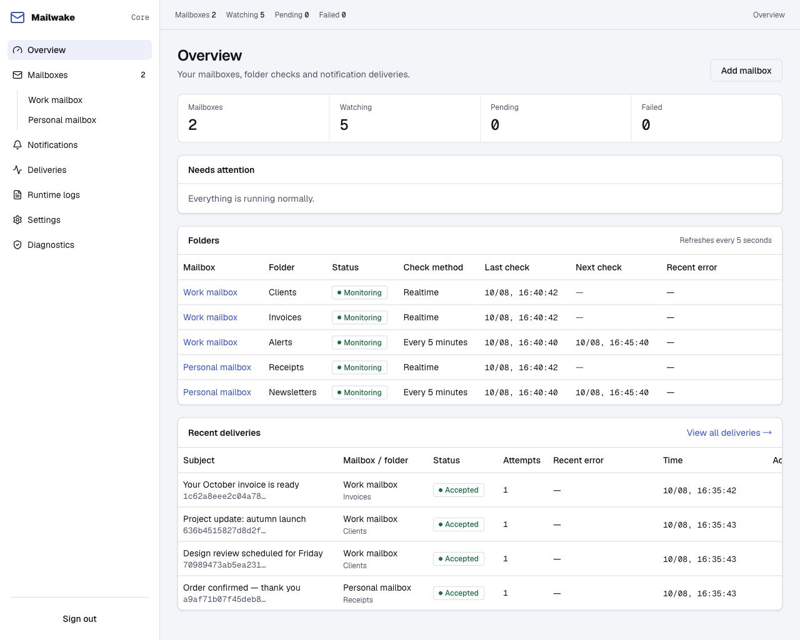
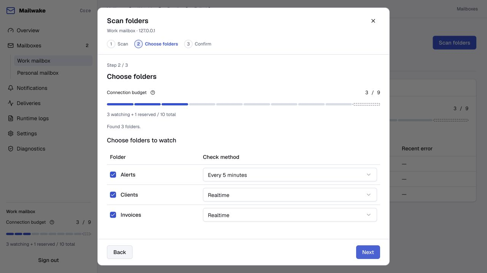

# Mailwake

**A quiet inbox. A signal when it matters.**

Self-hosted notifications for the IMAP folders you choose. Route important mail into a folder, let Mailwake watch it, and keep reading and replying in your usual email client.

[Documentation](https://mailwake.oritx.com/en/docs/) · [中文文档](https://mailwake.oritx.com/zh-cn/docs/) · [Releases](https://github.com/mingzaily/mailwake/releases) · [Contributing](CONTRIBUTING.md)

[](https://github.com/mingzaily/mailwake/actions/workflows/ci.yml)
[](LICENSE)



## Your folders, your server, your notifications

| Capability | How it works |
| --- | --- |
| Focused monitoring | Up to 20 mailboxes, with realtime IMAP IDLE or scheduled checks per folder |
| Your delivery channel | Bark, Pushover, signed webhooks, or the official Mailwake App |
| Browser management | A responsive console in nine languages, with connection status and delivery history |
| Durable state | Encrypted credentials, SQLite checkpoints and a persistent notification queue |

```text
Your mailbox → Your outpost → Bark / Pushover / Webhook
                           → Encrypted Relay → Mailwake App
```

A self-hosted Mailwake instance is called an **outpost** in the App and user guides. Contributor references use **Core** for the software and its repository.

The self-hosted console and script API are free. The official App's management features and ordinary native pushes use separate Pro entitlements; owner-approved body reading is free. See [App connection and permissions](https://mailwake.oritx.com/en/docs/connect-app/).

## Run from source

Install Git, Docker and Docker Compose v2, then run:

```sh
git clone https://github.com/mingzaily/mailwake.git
cd mailwake
docker compose up -d --build --pull never
docker compose logs core
```

Open **http://127.0.0.1:8080** on the Docker host. Enter the setup code from the logs, create an administrator password of at least 12 characters, and connect a TLS IMAP mailbox. Subscribe to a folder, save a notification channel, then send a **new** message to verify delivery.

This builds the current source. The default port is local to the host; the `core-data` volume preserves state. Prefer a released image or binary? Follow the [installation guide](https://mailwake.oritx.com/en/docs/deploy/) and select a published version from [Releases](https://github.com/mingzaily/mailwake/releases).

## Make it yours

| Next step | Guide |
| --- | --- |
| Install on a server or NAS | [Deployment](https://mailwake.oritx.com/en/docs/deploy/) |
| Reach Core from your phone | [HTTPS](https://mailwake.oritx.com/en/docs/https/) · [Connect the App](https://mailwake.oritx.com/en/docs/connect-app/) |
| Fine-tune monitoring | [Mailboxes](https://mailwake.oritx.com/en/docs/mailboxes/) · [Folders](https://mailwake.oritx.com/en/docs/folders/) |
| Configure delivery and automation | [Notifications](https://mailwake.oritx.com/en/docs/notifications/) · [HTTP API](https://mailwake.oritx.com/en/docs/api/) |
| Keep Core healthy | [Backup and upgrades](https://mailwake.oritx.com/en/docs/backup/) · [Troubleshooting](https://mailwake.oritx.com/en/docs/troubleshooting/) |

<details>
<summary>See folder selection and connection budgets</summary>



</details>

Screenshots use demonstration mailboxes and synthetic messages.

## Build with us

Start with [CONTRIBUTING.md](CONTRIBUTING.md) for the development environment and verification workflow. [docs/](docs/README.md) contains English contributor references for monitoring, delivery, storage, API implementation and the console. [AGENTS.md](AGENTS.md) maps development tasks to those references. User tutorials are maintained on the documentation site.

Report reproducible bugs in [Issues](https://github.com/mingzaily/mailwake/issues). Follow [SECURITY.md](SECURITY.md) for private vulnerability reports. Release history is maintained in [GitHub Releases](https://github.com/mingzaily/mailwake/releases).

## License

Mailwake Core is **AGPL-3.0-only**; see [LICENSE](LICENSE) and [COPYRIGHT](COPYRIGHT). Third-party components retain their licenses and notices. The Mailwake iOS App, Platform and Relay are separate proprietary modules and are distributed independently.
